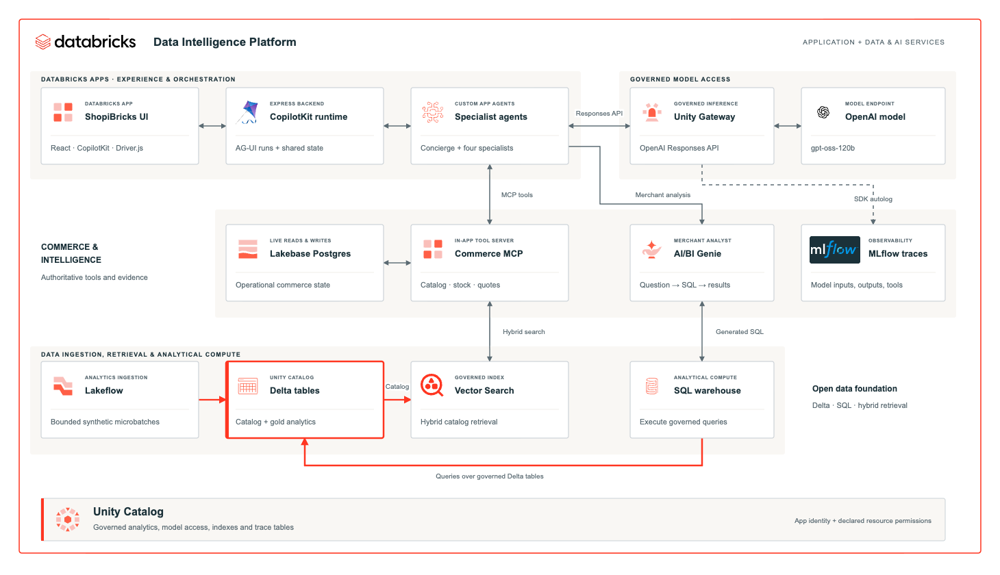
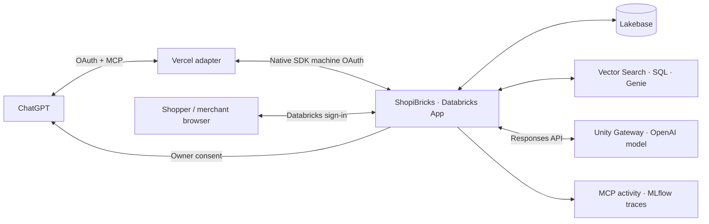

<div align="center">

# ShopiBricks

### From a shopping conversation to governed commerce.

A working demo of ChatGPT-connected shopping, merchant intelligence and human-confirmed checkout, built on Databricks.

    

[Install on Free Edition](docs/INSTALL_FREE_EDITION.md) · [Connect ChatGPT](#connect-chatgpt) · [Demo script](#demo-script) · [Architecture](docs/ARCHITECTURE.md)

</div>


ShopiBricks follows a shopper from discovery to a saved selection, then lets the merchant inspect the evidence behind that journey. Prices and stock come from Lakebase. Agents call bounded commerce tools. Genie answers merchant questions with inspectable SQL. The presenter can move between the shopper, merchant and developer views without leaving the app.

**ChatGPT is the conversational client. Databricks is the commerce backend.** The embedded ShopiBricks copilot separately calls OpenAI models through Unity Gateway. The Free Edition reference uses **GPT-OSS-120B served on Databricks**, with no direct `api.openai.com` call.

> Products, shoppers, campaign traffic and orders are fictional. Tool calls, database reads/writes and model execution are real when configured. Checkout never charges a payment or ships a product.

## What you can show

| Perspective | The experience | Evidence you can open |
|---|---|---|
| Shopper | Find a gift or travel kit, compare products, check stock, save a quote and review checkout | Current prices, inventory checks, quote expiry and a sandbox receipt |
| Merchant | Explore intent clusters, catalog gaps and captured ChatGPT discovery signals | Live journeys, source labels, product matches and Genie-generated SQL |
| Developer | Follow the concierge and specialist agents across tools and data | AG-UI events, MCP inputs/results, model traces and configured resource links |
| Presenter | Walk through the story with Driver.js highlights and speaker notes | 14-stop guided demo, downloadable talking points and two interactive architecture diagrams |

Four fictional shopper profiles have separate bags and conversations. Brand voices, catalog dossiers and the intent atlas support both guided presentation and hands-on exploration. The atlas has 72 labeled example questions plus a separate account-scoped activity view. Its deterministic TF-IDF / spherical k-means clusters and D3 layout are inspectable demo mechanics, not conversion predictions.

## Architecture



| Layer | What runs there |
|---|---|
| Experience | React 19, TypeScript, CopilotKit, D3, Driver.js |
| Application | Express, AG-UI, official MCP SDK, concierge and four specialist agents |
| Model access | OpenAI Responses through Databricks Unity Gateway |
| Operational truth | Lakebase Postgres for prices, stock, threads, quotes, orders and events |
| Analytics | Unity Catalog, Delta, Lakeflow, SQL warehouse, dashboard and Genie |
| Retrieval and traces | Hybrid Vector Search and MLflow |
| ChatGPT connection | Vercel Python Function for OAuth/MCP, relayed to the Databricks App |

The app's **Architecture** tab includes official product artwork, clickable components, presenter notes and self-contained SVG downloads. Its ChatGPT diagram presents the logical connection. The deployment guide shows the actual proxy and authentication path:



The proxy handles connection compatibility. Commerce logic and persistent OAuth records stay in Databricks. The dedicated bridge principal can use the relay, while the app principal executes the governed tools. This is a shared synthetic demo with application-level account scoping, not per-user delegated database execution.

## Install on Free Edition

Use the [complete installation guide](docs/INSTALL_FREE_EDITION.md) for the ordered provisioning commands, readiness checks and proxy setup. It covers a new workspace, not just an update to Laurent's demo.

**Prerequisites:** Node.js 22+, Python 3.12+, `uv`, Databricks CLI 1.x, a Free Edition workspace with the required services available, a Vercel team and a ChatGPT account with custom MCP apps enabled. Free Edition quotas and Vercel plan limits apply.

```sh
git clone https://github.com/laurentfabre/shopibricks.git
cd shopibricks
npm --prefix app ci
uv sync --project app
npm --prefix tests ci

databricks auth login --host https://YOUR-WORKSPACE.cloud.databricks.com --profile shopibricks-personal
cp deployments/free-edition.example.json deployments/shopibricks-personal.local.json
cp docs/examples/free-edition-target.yml resources/free-edition.local.yml
```

Edit the two local copies with your workspace, explicitly chosen CLI profile, user, SQL warehouse and resource names. They are ignored by Git. Then follow the [seven installation stages](docs/INSTALL_FREE_EDITION.md#1-clone-install-and-authenticate): preflight, synthetic data, infrastructure, analytics/Genie, app deployment, proxy deployment and ChatGPT linking.

| Free Edition detail | How this demo handles it |
|---|---|
| Model availability differs from enterprise workspaces | Uses the tested `system.ai.gpt-oss-120b` unified route |
| Unified model streaming returned incomplete tool arguments | Uses completed model responses; step and tool events still update |
| Lakebase CDC unavailable with Default Storage | Keeps operational data in Lakebase and labels the independent synthetic analytics |
| App lifecycle and compute quotas | Recheck app status before presenting; the tested app stopped automatically after 24 hours |
| Direct ChatGPT OAuth registration rejected | Uses the separately authenticated Vercel adapter |

Resource names and workspace IDs in the reference deployment files are nonsecret metadata. They do not grant access. The local overrides prevent you from deploying against the reference workspaces by accident when configured as documented.

### Proxy credentials

The [proxy installation steps](docs/INSTALL_FREE_EDITION.md#6-deploy-the-vercel-oauthmcp-adapter) create a dedicated service principal with App `CAN_USE` and a seven-day OAuth client secret. The helper reads `VERCEL_TOKEN` from the local `.env` you explicitly select and sends the generated machine secret directly into a sensitive Vercel production environment variable. It does not print or save that secret locally.

There is no Databricks PAT in the setup. ChatGPT receives bridge-scoped credentials after consent, never the Databricks machine secret. Do not put secret values in source files, README examples, screenshots or GitHub issues. See [credential handling and publication checks](SECURITY.md).

## Connect ChatGPT

First complete the app and proxy installation. Use **your own** bridge URL below.

1. In ChatGPT, enable developer mode if required by your plan/workspace and add a custom MCP app. UI labels can vary; custom apps must be permitted by your account policy.
2. Name it **ShopiBricks** and enter `https://YOUR-BRIDGE.vercel.app/mcp`.
3. Choose **OAuth** and **Dynamic client registration (DCR)** when offered. Leave client ID and client secret blank. Create a new connection rather than reusing an earlier failed Databricks registration.
4. Sign in to Databricks with the account configured in `expected_user`, then approve catalog, inventory and temporary quote access on the ShopiBricks consent page.
5. Start a new conversation, enable ShopiBricks and send:

   > Use ShopiBricks to list three products with their current prices and check their stock. Use the tools rather than guessing.

6. Confirm that ChatGPT actually invokes ShopiBricks. Open the app as the **same account**, then inspect **Merchant → Live journeys** or the **Developer studio** protocol timeline for the matching call.

A saved connection is not proof of a working tool call. Refresh the app's tool list after server changes, then start a fresh conversation.

| Exposed tool | What ChatGPT can do |
|---|---|
| `search_products` | Read the authoritative catalog and prices |
| `get_inventory` | Check current stock and freshness |
| `semantic_search` | Retrieve descriptive products from the governed index |
| `get_merchant_metrics` | Read operational metrics and separate analytical aggregates |
| `quote_cart` | Save a temporary selection and return its authenticated continuation link |

Four tools are read-only. `quote_cart` writes a **30-minute quote**, not an order or stock reservation. External ChatGPT access does not expose `ask_genie` or order confirmation. Genie is available through the in-app merchant analyst.

## Demo script

Allow 8–12 minutes for this cross-channel story. Open ChatGPT and the Databricks App side by side, signed in with the same owner account. For the longer in-app tour, choose **Present → Start guided demo**, enable **Speaker notes**, or **Download talking points**. Tours highlight and navigate without submitting prompts or confirming checkout.

| Step | Show | Say |
|---|---|---|
| 1. Explain the system | Architecture tab, then the ChatGPT diagram | “The conversation starts in ChatGPT. Databricks executes the commerce tools.” |
| 2. Discover and quote | Ask ChatGPT for a kit using the prompt below | “These prices and stock levels came from Lakebase. The model is choosing tools, not inventing inventory.” |
| 3. Follow the signal | Merchant → Live journeys, then the atlas activity source with ChatGPT selected | “We capture executed search arguments and tool outcomes, not the customer's full ChatGPT conversation.” |
| 4. Continue shopping | Open ChatGPT's saved quote link in ShopiBricks | “The selection follows the shopper. We recheck price and stock before they continue.” |
| 5. Ask the merchant analyst | Use Genie in the in-app merchant copilot | “This answer includes generated SQL and the executed result, under the app's identity.” |
| 6. Inspect and close | Developer studio, MLflow, then optional sandbox checkout | “Tool evidence, model traces and orders are different records. Only explicit confirmation creates a sandbox order.” |

### Shopper prompt in ChatGPT

> Use ShopiBricks to build a Paris weekend kit under €250, including an audio product and a bag. Search the catalog, check live inventory, and quote the kit. Return the link so I can review it in ShopiBricks. Do not place an order.

If a product is unavailable, ask for an in-stock alternative within the same total budget. Open the continuation URL before the quote expires. Opening the link alone creates no checkout; choosing to continue creates a draft. Confirm only when you intentionally want to consume fictional demo stock.

### Merchant prompts in the app

> Summarize my recent ChatGPT shopping activity. Which products were searched or quoted? Show the supporting MCP calls, then open Live journeys.

> Use Genie to show the top five products by stockout exposure in the synthetic campaign data. Show the generated SQL and executed result. Explain why this is not confirmed lost revenue.

In **Developer studio**, look for `ask_genie`, `query_results` and `statement_id`, then use the configured Genie link to show the backend space. A direct metrics read is not a Genie execution. The external ChatGPT tool allowlist intentionally differs from the in-app merchant tools.

For a native shopper comparison, choose Noor and ask the embedded copilot:

> Build a useful weekend travel kit under €300. Check live inventory and explain each choice. Keep the full selection within the budget.

The [presenter cues](docs/PRESENTER_CUES.md) and [CopilotKit journey guide](docs/COPILOT_JOURNEYS.md) include deeper walkthroughs and fallback language.

## Before the next demo

| Symptom | Check or action |
|---|---|
| App unavailable | Start it from Databricks Apps, wait for startup, then check Lakebase connectivity |
| Proxy returns 503 | Check app status, bridge App permission and the seven-day machine secret; rotate and redeploy if expired |
| Databricks rejects a ChatGPT client ID | Use the Vercel `/mcp` URL with DCR; do not paste an unrelated OAuth client ID |
| Consent expired or session changed | Reconnect from ChatGPT in the same browser and use the allowlisted Databricks identity |
| Grant expired | Reconnect after its eight-hour lifetime |
| Quote expired or prices changed | Request a fresh quote and review current stock/prices |
| Empty merchant activity | Generate a real tool call and view it as the same owner; keep fictional examples labeled |
| Stale analytics | Inspect the timestamp and run a bounded synthetic refresh if needed |

Machine-secret rotation and the verification commands are in the [installation maintenance section](docs/INSTALL_FREE_EDITION.md#maintenance-and-local-development). Vercel `/health` checks configuration, not end-to-end backend access. Updating environment variables requires a new Vercel deployment. GitHub pushes do not redeploy the current file-based Vercel project.

## Develop and verify

After provisioning, copy `app/.env.example` to `app/.env` and fill in your own resource metadata. Build and run from `app/` with `npm run build` and `npm run dev`; open `http://localhost:8000`. Local development uses your OAuth identity, so use a dedicated development database or explicit grants rather than changing the hosted app's table ownership.

```sh
npm --prefix app test
npm --prefix app run build
app/.venv/bin/python -m unittest discover -s bridge/tests

# With the local app running and Google Chrome installed:
npm --prefix tests run verify:architecture
npm --prefix tests run verify:journeys
npm --prefix tests run verify:atlas
npm --prefix tests run verify:presenter

# Deployment helper checks use synthetic configuration and no cloud calls:
app/.venv/bin/python -m unittest discover -s scripts/tests
```

Browser checks use isolated Chrome and explicit API fixtures. Run application tests first to generate the atlas fixture. Hosted checks are separate and use native Databricks OAuth:

```sh
app/.venv/bin/python -P scripts/verify_workspace.py app --target shopibricks-personal
app/.venv/bin/python -P scripts/verify_bridge.py --profile shopibricks-personal --browser
```

The last hosted app verification on **November 19, 2026** passed 26 checks, with 35 architecture browser checks and Databricks Apps validation. The connected-journey release also passed 47 application tests, 8 Python bridge tests and 32 hosted bridge checks. Laurent confirmed a real ChatGPT product retrieval on that date. These are dated observations, not a claim that another workspace or today's live credentials have been checked. See [validation records](docs/VALIDATION.md).

## Explore the repository

| Path | Contents |
|---|---|
| [`app/`](app/) | React UI, Express backend, commerce contracts, agents and tests |
| [`bridge/`](bridge/) | Vercel OAuth/MCP adapter and tests |
| [`data/`](data/) | Synthetic catalog, bounded event generator, Lakeflow and SQL |
| [`resources/`](resources/) | Bundle pipeline/jobs/dashboard and reference resource definitions |
| [`deployments/`](deployments/) | Reference configurations and the Free Edition template |
| [`scripts/`](scripts/) | Provisioning, secret-safe proxy deployment and hosted verification |
| [`tests/`](tests/) | Browser and journey regression checks |
| [`docs/`](docs/) | Installation, architecture, demo narration and verification evidence |

<details>
<summary>Reference deployments and deeper reading</summary>

- [Personal Free Edition reference](docs/PERSONAL_FREE_EDITION.md), [emerging-hackathon](docs/EMERGING_HACKATHON.md), and the [original rehearsal runbook](docs/RUNBOOK.md).
- [App architecture](docs/ARCHITECTURE.md), [OAuth/MCP protocol flow](docs/VERCEL_BRIDGE.md), [intent atlas](docs/INTENT_ATLAS.md), [personas](docs/PERSONAS_AND_GROWTH.md) and [ACP readiness](docs/ACP_READINESS.md).
- [Laurent's hosted personal demo](https://shopibricks-personal-7474650310803801.aws.databricksapps.com) requires workspace access. Clone and install your own copy to use your own account.

</details>

**Scope.** MCP events are application telemetry around tool execution. They do not push unsolicited messages into ChatGPT. ACP checkout is a sandbox merchant contract, not native ChatGPT checkout or completed merchant onboarding. Other named shopping channels are not connected. Search relevance and synthetic stockout exposure are not conversion probabilities or booked losses.

The public discovery and clustering themes on [Lemrock](https://www.lemrock.com/) informed the experience. ShopiBricks is independent. Brand artwork belongs to its respective owners; [official asset sources](app/client/public/brand/SOURCES.json) are included.
