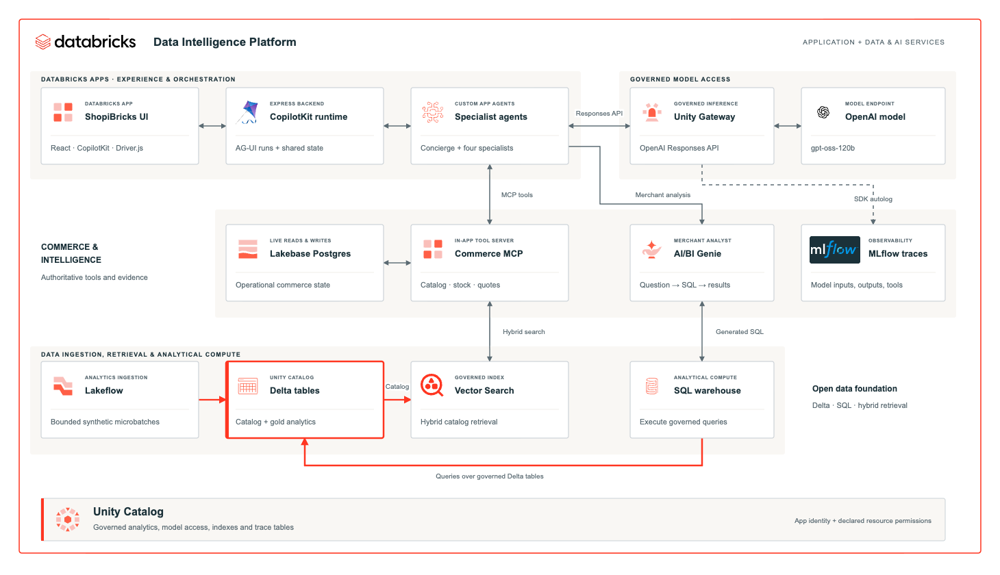
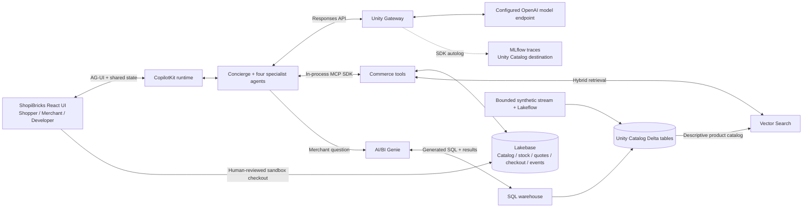
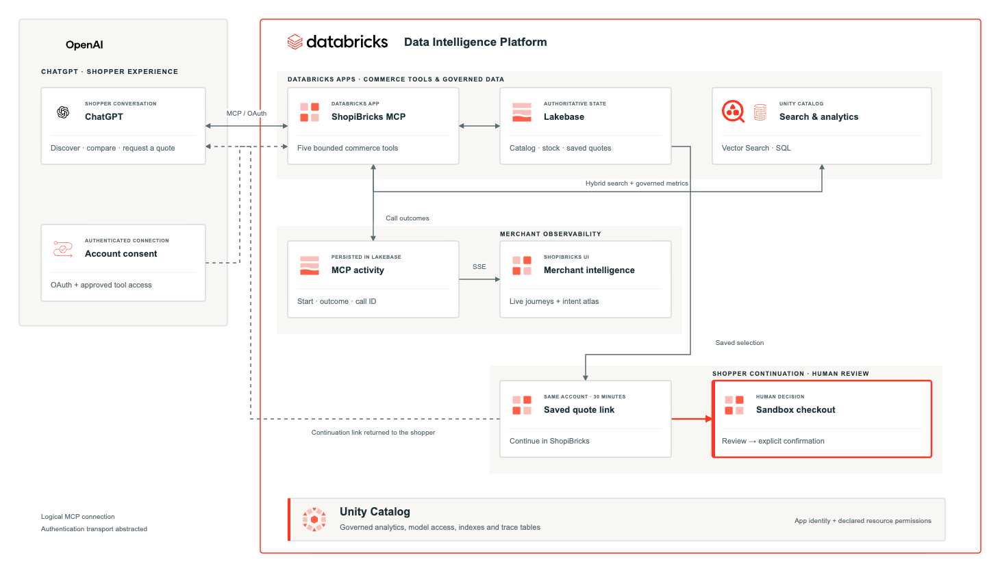
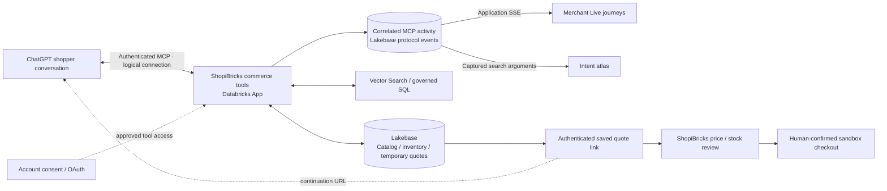

# ShopiBricks architecture

The app’s **Architecture** workspace tab contains two interactive presentation diagrams with component details, talking points, configured Databricks resource links and standalone SVG downloads. Both are logical architecture views. The ChatGPT view abstracts authentication transport and omits the proxy provider from the presentation.

Open the personal demo directly:

- [App & Databricks](https://shopibricks-personal-7474650310803801.aws.databricksapps.com/?view=architecture)
- [ChatGPT & Databricks](https://shopibricks-personal-7474650310803801.aws.databricksapps.com/?view=architecture&diagram=chatgpt)

The code supports separate FEVM, emerging-hackathon and personal Free Edition deployments. Runtime configuration supplies the model, workspace and resource links. Products, profiles, campaign traffic and orders are synthetic. The new Architecture tab is deployed to the personal target.

## Presentation design and official artwork

The interactive diagrams use the Databricks reference architecture layout: a lava-red platform boundary, navy labels, oat service groups, rectangular product cards and a Unity Catalog governance foundation. Selecting a component highlights its connections and exposes its role, evidence and configured resource links.

Official Databricks product artwork represents Apps, Lakebase, Lakeflow, Genie, Unity Catalog and Unity AI Gateway. Official architecture/concept icons represent SQL warehouses, Delta tables, search, authentication and custom app agents. The agents are not labeled Agent Bricks. Official OpenAI, MLflow and CopilotKit artwork completes the integration view. Original SVG geometry and colors are preserved; the MLflow wordmark has a dark backing for contrast.

[Asset sources and SHA-256 hashes](../app/client/public/brand/SOURCES.json) record provenance. The original assets are imported as inline data URIs, so downloaded SVGs include every logo and render offline. Keyboard navigation, component controls on mobile, presenter talking points and execution links remain available.

## 1. App, Databricks and Unity Gateway to OpenAI

The personal deployment uses **OpenAI GPT-OSS-120B served on Databricks**, through the configured gateway route. It does not make a direct model request to `api.openai.com`. Other deployments use their configured OpenAI endpoint; the diagram reads the actual model name from `/api/health`.

CopilotKit runs inside ShopiBricks. Its owner-scoped runtime wraps the existing agents and streams AG-UI text, tool results, validated product cards and display-only navigation. It requires no CopilotKit cloud account. Conversation history is persisted in Lakebase and isolated by authenticated account, persona, profile, channel and voice.

The concierge delegates to Catalog, Inventory, Checkout and Merchant analyst. Catalog cards require an authoritative inventory check and server-enforced selection budget. Generated content selects known React components; it is not arbitrary executable UI.

Explicitly asking **“Use Genie”** routes the merchant analyst to the configured Genie space. The backend returns generated SQL, executed query results and statement IDs. Genie executes under the app service principal. Direct merchant metric queries and MCP activity summaries are separate tools and are not labeled Genie execution.

**Presenter line:** “CopilotKit connects the experience to our agents. Unity Gateway provides governed OpenAI model access. The tools ground each answer in Databricks data, and Genie turns merchant questions into inspectable SQL.”

## 2. ChatGPT connected to Databricks

ChatGPT selects tools; Databricks executes commerce logic. The five exposed tools are `search_products`, `get_inventory`, `semantic_search`, `get_merchant_metrics` and `quote_cart`. Four are read-only; `quote_cart` saves a temporary selection and returns a continuation URL. `ask_genie` is an internal merchant-agent tool, not part of the external ChatGPT allowlist.

The logical connection shown here does not claim direct native ChatGPT-to-Databricks OAuth registration. Implementation and connection setup remain documented in [the connection runbook](VERCEL_BRIDGE.md).

MCP events are application telemetry around executed calls: source, correlated call ID, start/outcome, duration, bounded product IDs and saved quote references. They do not contain the full ChatGPT conversation. A separate owner-scoped SSE feed updates the merchant browser. Search arguments feed the intent atlas with explicit external-source labels and no invented shopper profile.

A quote lasts 30 minutes and belongs to the authenticated account. Opening its link rechecks current prices and inventory but creates no checkout. Choosing to continue creates an incomplete draft. Order completion stays behind explicit human confirmation in ShopiBricks. There are no real payments, shipments or native ChatGPT checkout claims.

**Presenter line:** “The conversation starts in ChatGPT. Databricks executes the commerce tools and records the evidence. The merchant sees real discovery signals, while the shopper can carry a saved selection into an explicitly reviewed checkout.”

## Operational and analytical truth

Lakebase provides current price and stock. Checkout uses transactions, row locks, authoritative recomputation and request-bound idempotency. Confirming a sandbox order changes actual demo inventory.

The campaign stream is independent: a bounded serverless job emits synthetic microbatches into a Unity Catalog volume, then Lakeflow produces bronze, silver and gold datasets. Gold metrics refresh after pipeline completion. Synthetic traffic revenue and stockout exposure are not actual sandbox sales or confirmed lost revenue. Descriptive catalog/vector data never substitutes for live inventory checks.

Native Lakebase CDC is available in the configured FEVM/hackathon deployments but **unavailable on the personal Free Edition target**. The diagrams therefore do not imply operational order replication into Delta. Consult the target runbooks for the specific bindings and supported paths.

## Identity and observability

The hosted app authenticates users at the platform boundary and uses its attached service principal for shared demo data, model access, SQL, Genie, MLflow and jobs. Application-level ownership scopes conversations, quotes, orders and protocol events. This is not per-user delegated database execution. Native SDKs handle authentication; credentials stay out of source control.

Lakebase retains correlated application events. MLflow OpenAI autolog separately records model inputs, outputs and tool calls in the configured experiment and Unity Catalog trace destination. Developer studio exposes event payloads and links to the configured Genie, MLflow, pipeline and job resources. A protocol event alone does not establish external delivery or a sale.

See [CopilotKit journeys](COPILOT_JOURNEYS.md), [personal deployment](PERSONAL_FREE_EDITION.md), [hackathon deployment](EMERGING_HACKATHON.md) and [validation](VALIDATION.md) for implementation, target limitations and dated verification.
