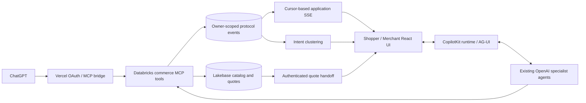

# CopilotKit and MCP journeys

The personal deployment connects two experiences: an in-app CopilotKit copilot for shoppers and merchants, and the existing authenticated ChatGPT MCP bridge. Both use the same Databricks commerce tools and Lakebase catalog.

| Perspective | What to demonstrate | Evidence |
|---|---|---|
| Shopper in ChatGPT | Find a kit, check stock, request a quote and its continuation link | Successful MCP tools; quote ID and expiry |
| Shopper in ShopiBricks | Open the saved selection, review refreshed prices and stock, explicitly continue to checkout | Owner-bound quote; changed-price disclosure; unavailable-stock state |
| Merchant | Open **Discovery intelligence → Live journeys**, filter ChatGPT, select a call | Source, start/outcome correlation, duration, returned IDs and recorded payload |
| Merchant copilot | Ask about recent MCP discovery calls or a selected search; ask it to open Live journeys | Account-scoped `get_discovery_activity`; AG-UI shared-state navigation |
| Intent analysis | Open **Intent atlas → My live activity**, select **ChatGPT tool searches** | Captured search arguments, with no invented shopper profile |

## A five-minute demonstration

1. Sign in to the personal app as the same account used for the ChatGPT connection. Open **Live journeys** in one tab.
2. In ChatGPT, select **ShopiBricks Personal Bridge** and ask: **“Find a Paris weekend kit under €250. Check current stock and give me a quote with a link to continue in ShopiBricks.”** If ChatGPT has cached the older tool descriptions, refresh the app's tools or reconnect it.
3. Return to the merchant tab. Select a search and its recorded outcome. Say: **“These are actual tool-search signals. We do not receive the full ChatGPT conversation or infer a purchase.”**
4. Open the quote link. Say: **“The selection survives the channel handoff. Price and stock are checked again; the link is scoped to my account.”** Click **Review sandbox checkout**. An incomplete draft is created, never an order. Use fictional delivery details and confirm only if you intend to change demo stock.
5. In Merchant, ask: **“Summarize my recent MCP discovery calls, then open Live journeys.”** Inspect the actual discovery tool and navigation state in Developer studio.

**Present → Start guided demo** includes the Live journeys highlight. Downloadable talking points and [presenter cues](PRESENTER_CUES.md) include the same story.

## Architecture



CopilotKit runs inside ShopiBricks. The TypeScript runtime wraps the existing agents through an `AbstractAgent`; model execution remains in the native Databricks gateway. No CopilotKit cloud account, extra model key or enterprise self-managed-agent feature is required. The frontend uses shared state and tool renderers while retaining the existing product cards, branding and explicit checkout UI.

The runtime derives identity from the app's verified request middleware, not from client state. Its runner scopes all thread operations by identity. Lakebase retains owner/persona/profile/channel/voice-scoped conversation history; the bounded in-memory CopilotKit runner holds transient transport replay. App restart clears that replay cache, not persisted conversation history. Browser conversation restoration across a full page reload is not implemented.

The UI shares the current persona, view and bag item IDs/quantities. These are user inputs, never trusted prices, inventory or permissions. Merchant navigation is a validated display-only state update. `get_discovery_activity` is an internal analyst tool; the bridge keeps its existing five-tool allowlist.

## What “MCP Events” means here

These are ShopiBricks application events around real MCP calls, not a claim that an external assistant subscribes to a new MCP notification standard. The public bridge remains stateless POST Streamable HTTP. The merchant browser receives a separate application SSE stream at `/api/events/stream`.

Each observed call records a version, random call ID, channel, tool, start/completed/failed phase, timestamp, duration, and bounded commerce result summary. Search tools record their query argument. Successful quotes record their quote ID. OAuth secrets, grants, buyer details and complete ChatGPT conversations are not copied into these events. Failed tool execution is distinguishable from a completed empty search; malformed requests rejected before tool execution are not counted as calls.

SSE uses persisted database IDs as cursors, supports `Last-Event-ID`, deduplicates client replay, closes after 55 seconds and reconnects. Database reads poll every two seconds while connected. The initial window is the latest 300 protocol events; the client retains up to 600. A start without a terminal event remains “awaiting outcome,” rather than being labeled successful. The UI discloses reconnecting state and window counts. These counts are not sessions, impressions, conversion rates or attributed revenue.

The atlas uses up to 180 recent questions/search signals from an owner-scoped, bounded 24-hour event read. Its TF-IDF / spherical k-means method remains unchanged. External search arguments are labeled `tool_search`; blank catalog browses are omitted. In-app MCP searches do not duplicate their original shopper prompt. Current catalog matches are estimates, distinct from observed tool results.

## Quote and checkout boundaries

- `quote_cart` stores the exact selection, initial total, owner, source and 30-minute expiry in the app-owned `shopibricks_journeys.quotes` schema. It returns the existing price response plus `quote_id`, `expires_at` and `continuation_url`.
- Quote storage is a non-destructive write, accurately advertised with `readOnlyHint: false`. The four other tools remain read-only. The bridge's historical OAuth scope name `shopibricks:read` is retained for connection compatibility; its consent text now explicitly describes temporary quote storage. It still grants no stock, order or payment mutations.
- Opening a quote does not create checkout. The app checks the signed-in owner, expiry and current catalog; changed totals are disclosed. Quote expiry controls usability; it is not a database retention/deletion schedule.
- **Review sandbox checkout** creates a draft through an idempotent, transactional endpoint. Checkout revalidates catalog rows and availability. The existing delivery and unchecked confirmation UI controls sandbox order completion. The bridge cannot call that endpoint.
- CopilotKit does not add rich widgets inside ChatGPT, native ChatGPT checkout, production payments or merchant certification. Those are separate integrations.

## Build and verification

CopilotKit is pinned to `2.0.0-rc.44`, the v2 release available through the configured package proxy, with AG-UI `1.0.4`. The core/shared transitive packages are aligned to that same release so unused channel dependencies do not pull in the legacy v1 stack; `fflate` is patched to `0.8.3`. No managed channels are enabled. Re-run the runtime, browser and hosted checks when upgrading these prerelease dependencies. The lockfile retains public npm URLs; local installation can use the configured enterprise proxy with `--registry`.

```sh
npm --prefix app test
npm --prefix app run build
databricks apps validate --profile shopibricks-personal
cd tests
SHOPIBRICKS_TEST_URL=http://localhost:8000 node verify-journeys.mjs
SHOPIBRICKS_TEST_URL=http://localhost:8000 node verify-atlas.mjs
SHOPIBRICKS_TEST_URL=http://localhost:8000 node verify-presenter.mjs
cd ..
app/.venv/bin/python -P scripts/verify_journeys.py --profile shopibricks-personal
app/.venv/bin/python -P scripts/verify_bridge.py --profile shopibricks-personal --browser
```

Hosted journey verification creates one temporary quote and incomplete draft, runs shopper and merchant agents, and checks persisted event replay. It never confirms an order. Sanitized reports remain under ignored `.local/deploy/shopibricks-personal/`; browser fixtures and screenshots are explicitly labeled test evidence.

References: [CopilotKit runtime](https://docs.copilotkit.ai/backend/copilot-runtime), [custom AG-UI agent](https://docs.copilotkit.ai/backend/custom-ag-ui-agent), [shared state](https://docs.copilotkit.ai/shared-state), [tool rendering](https://docs.copilotkit.ai/generative-ui/tool-rendering), [runtime authentication](https://docs.copilotkit.ai/auth).
