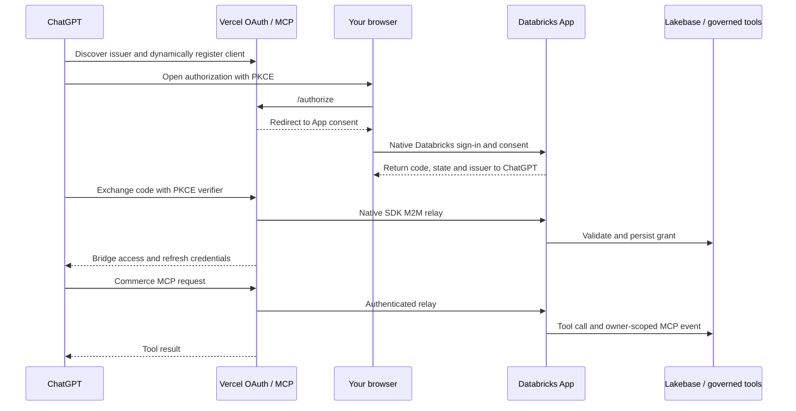

# ChatGPT through the Vercel MCP bridge

The personal demo has a separate OAuth issuer on Vercel. This avoids asking Databricks to register ChatGPT's connector-specific client metadata URL. Databricks still authenticates the owner through the existing App login and authenticates the dedicated bridge service principal through native M2M OAuth.

**MCP URL:** https://shopibricks-mcp-personal.vercel.app/mcp

**App:** https://shopibricks-personal-7474650310803801.aws.databricksapps.com

## Connect ChatGPT

1. In ChatGPT, enable developer mode if needed, then create a **new** custom app named **ShopiBricks Personal Bridge**.
2. Enter the MCP URL above and select **OAuth**. Select **Dynamic client registration (DCR)** if a registration-method choice appears. Leave client ID and client secret empty. Do not reuse the old Databricks client ID or the previous failed connector.
3. When redirected to Databricks, sign in as **laurent.fabre@gmail.com**. On the ShopiBricks consent screen, choose **Allow catalog, inventory and temporary quote access**.
4. Return to ChatGPT, enable the new app in the conversation, and ask:

   > Use ShopiBricks to build a Paris weekend kit under €250, including an audio product and a bag. Search the catalog, check live inventory, and quote the kit. Do not place an order.

5. Open the Databricks App with the same Gmail account, select **Developer studio**, and inspect an **mcp** entry in the **Live protocol timeline**. Its event payload includes the transport **ChatGPT → Vercel → Databricks App**. The app retains the Driver.js tour, speaker notes, personas and clustering atlas.

**Live ChatGPT connection confirmed on 19 November 2026.** Laurent selected the app in ChatGPT and confirmed that it called ShopiBricks and returned products. A separate read-only check found an active ChatGPT grant created at 14:25 UTC and 14 recent authenticated MCP requests, excluding automated-verification grants. This confirms the real user connection in addition to the automated consent, code exchange, MCP, refresh and revocation checks.

## What runs where



Vercel hosts a Python Function using FastAPI. The streamable HTTP endpoint responds with JSON; it has no long-lived SSE connection or in-memory sessions. Lakebase owns the persistent OAuth records in a separate `shopibricks_bridge` schema. Only hashes of authorization codes and bridge credentials are stored.

The dedicated `shopibricks-vercel-bridge` principal has **CAN_USE on the personal App**. Its App middleware permits only `/bridge/relay`; it cannot use the ordinary checkout or mutation APIs. The App's existing service principal executes the governed tools. This is the owner's synthetic demo access, not per-user Databricks data delegation.

| Tool | Demo purpose |
|---|---|
| `search_products` | Authoritative 12-product Lakebase catalog and prices |
| `get_inventory` | Current stock and freshness |
| `quote_cart` | Save a 30-minute quote and authenticated app continuation link, without creating an order |
| `semantic_search` | Hybrid retrieval from the governed product index |
| `get_merchant_metrics` | Lakebase operational data and Lakehouse aggregates |

ACP checkout stays in the ShopiBricks app and requires human confirmation. The bridge does not enable ChatGPT native checkout or replace merchant onboarding.

## Demo talking points

- “ChatGPT is calling the same live commerce tools as the storefront.”
- “The stock and prices come from Lakebase; semantic search uses the governed Databricks index.”
- “Consent grants four read-only tools and temporary quote storage. A quote does not create an order.”
- “Here is the actual MCP event persisted for my account. The bridge changes how ChatGPT connects; the data and tool execution remain in Databricks.”
- Continue in the storefront with a persona, the question-clustering atlas, and the guided presenter tour. Complete sandbox ACP checkout there to demonstrate the separate confirmation boundary.

## Lifetimes and operation

| Item | Lifetime |
|---|---|
| Pending browser consent | 5 minutes |
| One-use authorization code | 60 seconds |
| Bridge access credential | Up to 10 minutes |
| Grant and rotating refresh credentials | Up to 8 hours, then connect again |
| Dynamic client registration | 30 days |
| Databricks machine OAuth client secret | 7 days |

The initial machine secret expires **26 November 2026 at 13:10 UTC**. Rotate before the next demo if necessary. The Free Edition App also stops automatically after 24 hours and may need starting from the Databricks Apps page. Vercel `/health` checks configuration only; use the hosted verifier to check the backend.

The deployment helper uses the explicitly authorized `VERCEL_TOKEN` from `../.env` because Vercel MCP did not have access to team `lf-dd9e`. It never prints the token or saves generated client-secret values locally. The native Databricks CLI/SDK uses the explicitly chosen `shopibricks-personal` profile. Vercel stores the machine secret as a sensitive production environment variable.

Run phases sequentially from the repository root. Updates use file deployments; the Vercel project is not connected to GitHub automatic deployments.

```sh
# Existing infrastructure: publish an updated Python Function.
app/.venv/bin/python -P scripts/deploy_bridge.py deploy --vercel-env-file ../.env
app/.venv/bin/python -P scripts/deploy_bridge.py status --vercel-env-file ../.env

# If the App-side implementation changed, deploy that separately.
app/.venv/bin/python -P scripts/deploy_workspace.py deploy --target shopibricks-personal

# Test the real OAuth flow and tools; the temporary grant is revoked afterwards.
app/.venv/bin/python -P scripts/verify_bridge.py --profile shopibricks-personal --browser
```

Rotate the machine secret without displaying or manually copying it:

```sh
app/.venv/bin/python -P scripts/deploy_bridge.py environment --rotate-secret --vercel-env-file ../.env
app/.venv/bin/python -P scripts/deploy_bridge.py deploy --vercel-env-file ../.env
app/.venv/bin/python -P scripts/deploy_bridge.py status --vercel-env-file ../.env
app/.venv/bin/python -P scripts/verify_bridge.py --profile shopibricks-personal --browser
```

Wait for `READY` before verifying. Updating Vercel environment variables alone does not update an existing deployment. The prior seven-day secret expires naturally, preserving a short rollback window. To disable the entire bridge immediately, remove this dedicated principal's `CAN_USE` permission from the personal App. Bridge `/revoke` invalidates an individual grant; grants also expire after eight hours.

For initial provisioning, the helper phases are `audit`, `project`, `principal`, `environment`, then the App deployment, then `deploy` and `status`. Resource identifiers and credential metadata are in ignored `docs/deployment.shopibricks-personal.json`. Never commit this inventory or `.env` files.

## Verification and troubleshooting

Verified on November 19 with the CopilotKit journey update: **47 TypeScript tests**, **8 Python bridge tests**, and the production build pass. **32 hosted checks pass with `--browser`**, covering Chrome's actual consent origin and secure cookie, registration, PKCE, one-use codes, bounded tool discovery, all five tools, saved quotes and authenticated restoration, persisted MCP events, refresh and revocation. The app also passes **24 hosted regression checks** and **19 hosted CopilotKit/journey checks**. See [validation details](VALIDATION.md). Sanitized reports live under ignored `.local/deploy/shopibricks-personal/`.

`--browser` requires Google Chrome and the Playwright dependency installed by `npm --prefix tests ci`. It renders the deployed consent HTML and response headers in isolated Chrome, then forwards the browser-generated form, origin and cookie through the native Databricks SDK. It does not read browser credentials or visit ChatGPT's callback. Without this option the verifier supplies the origin/cookie itself, which cannot detect browser-policy regressions.

The initial browser approval failed because `Referrer-Policy: no-referrer` made Chrome submit `Origin: null`. The strict approval-origin check rejected it, and the previous generic error incorrectly said “Approval expired.” The consent policy now uses `same-origin`, preserving the origin check while suppressing referrers to ChatGPT. Fixed diagnostic references distinguish origin, form, session and grant failures without logging credentials.

- **Databricks reports the old ChatGPT client ID:** check the connector URL. It must be the Vercel `/mcp`, and the connection must use DCR rather than the previous manually configured client.
- **Access unavailable on consent:** use the allowlisted Gmail identity, not a different Databricks login.
- **Approval expired:** close the old consent page and reconnect from ChatGPT; consent and codes are deliberately short-lived.
- **Approval could not be verified / Approval session changed:** note the fixed `Reference` shown on the page (`origin`, `form`, `session` or `grant`). Reconnect from ChatGPT in the same browser. Do not refresh an old approval POST.
- **503 backend unavailable:** check the App is running, the machine secret has not expired, and the principal retains App access. Run the hosted verifier. No native credentials are exposed in public errors.
- **401 after an extended demo:** connect again after the eight-hour grant expires.
- **429:** the demo caps registration at 30/hour, token exchanges at 200/client/hour, and MCP requests at 120/grant per ten minutes. Wait for the window to expire.

Direct ChatGPT → Databricks OAuth remains a separate blocked path, documented in [PERSONAL_FREE_EDITION.md](PERSONAL_FREE_EDITION.md). FEVM and emerging-hackathon deployments are unchanged.

## Continue the conversation in the app

The [CopilotKit journey](COPILOT_JOURNEYS.md) adds **Live journeys** for the merchant and saved quote links for the shopper. `quote_cart` is now accurately marked as a non-destructive write because it persists a temporary selection. Refresh ChatGPT’s tool list if it still shows the older description. CopilotKit is embedded in ShopiBricks; the Vercel endpoint and existing OAuth connection stay the same.
